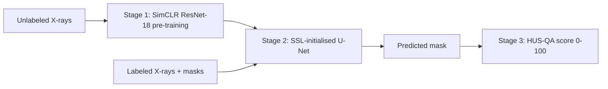

# HUS-QA: Quality Assurance for Dental X-ray Segmentation without Ground Truth

[](https://colab.research.google.com/github/Fatema5007/hus-qa-dental-segmentation/blob/main/hus_qa_dental_segmentation.ipynb)

Code for the paper **"Beyond Ground Truth: A Heuristic Unsupervised Quality Assurance Engine for Diagnosing Calibrational Blindness in Dental Segmentation"**, 11th IEEE Asia-Pacific Conference on Computer Science and Data Engineering (IEEE CSDE 2026).

## Problem

Deep segmentation models often stay highly confident even when the mask is wrong (*calibrational blindness*). In clinics there is no ground-truth mask to check against. On periapical X-rays, the usual confidence score does not follow the real mask quality: a nearly empty mask can still get 99.96% confidence.

**HUS-QA** (Heuristic Unsupervised Quality Assurance) gives each predicted mask a score from 0 to 100 using only the model output. A low score tells the clinician to check the mask by hand.

## Pipeline



## How HUS-QA works

| Indicator | Idea |
|---|---|
| Prediction confidence (Q_c) | Spread (std) of the probability map, scaled to 0-100 |
| Boundary sharpness (Q_s) | Mean Sobel gradient of the probability map, scaled to 0-100 |
| Structural connectivity (Q_str) | 100 for one connected region, minus 35 for each extra region |
| Area consistency (P_area) | Factor below 1 when the mask covers more than 25% of the image |

```
Q = (0.40 * Q_c + 0.40 * Q_s + 0.20 * Q_str) * P_area        (clipped to 0-100)
```

All constants are defined at the top of the HUS-QA cell in the notebook.

## Results (from the paper)

**Segmentation (Table I)**

| Accuracy | Dice | IoU |
|---|---|---|
| 0.9872 | 0.6961 | 0.5666 |

**Quality assessment (Table II)**

| Method | Pearson r | p-value | ROC-AUC |
|---|---|---|---|
| Baseline confidence | -0.1394 | 1.7864e-03 | 0.4275 |
| **HUS-QA** | **0.4647** | **3.7510e-28** | **0.8405** |

**Threshold sensitivity (Table III)**

| Dice threshold | HUS-QA AUC | Baseline AUC |
|---|---|---|
| 0.60 | 0.8279 | 0.3461 |
| 0.65 | 0.8397 | 0.3957 |
| 0.70 | 0.8405 | 0.4275 |
| 0.75 | 0.8238 | 0.4796 |
| 0.80 | 0.8264 | 0.5506 |

## Repository contents

| File | Description |
|---|---|
| `hus_qa_dental_segmentation.ipynb` | Full pipeline: Stage 1, Stage 2, Stage 3, and the code for Tables I-III and Figures 2-5 |
| `requirements.txt` | Python packages |
| `LICENSE` | MIT license (code only) |

## Getting started

### 1. Data

The notebook uses the **PRAD periapical dental X-ray dataset**. The images are not included in this repository. Please get the dataset from its original source and follow its license. Arrange it like this (the names can be changed in the config cell):

```
Dental_QA_Project/
└── dataset/
    ├── Unlabeled_Pretrain/
    │   └── images/                  # 2,500 unlabeled images (Stage 1)
    └── Labeled_Downstream/
        ├── train_images/  train_masks/    # 1,750 pairs
        ├── valid_images/  valid_masks/    #   250 pairs
        └── test_images/   test_masks/     #   500 pairs
```

An image and its mask must have the same file name (for example `0001.jpg` and `0001.png`).

### 2. Run

**Google Colab (recommended):** click the Colab badge above, select a GPU runtime, set the paths in the config cell, and run all cells.

**Local:**

```bash
git clone https://github.com/Fatema5007/hus-qa-dental-segmentation.git
cd hus-qa-dental-segmentation
pip install -r requirements.txt
jupyter notebook hus_qa_dental_segmentation.ipynb
```

Then change `PROJECT_DIR` in the config cell to a folder on your computer.

### 3. Outputs

Figures (PNG and PDF), `test_results.csv` (per-image Dice and QA scores) and `threshold_sensitivity.csv` are saved in `PROJECT_DIR/results`.

## Implementation notes

- **Resuming and skipping.** Stage 1 and Stage 2 are skipped if their weight files already exist. Set `FORCE_RETRAIN = True` to train again. Stage 1 saves a checkpoint every 5 epochs and resumes automatically.
- **Empty masks.** If the model predicts fewer than 5 foreground pixels, HUS-QA uses a separate rule. When all probabilities stay below 0.05, the score is between 95 and 100 (the model sees nothing). When some probability is above 0.05, the score is `25 * (1 - max probability)`, which is a low score.
- **One image at a time.** `hus_qa_score` takes the probability map of a single image (a 2-D NumPy array with values from 0 to 1).
- **Baseline score.** The baseline is the mean pixel confidence, `mean(|p - 0.5| * 2) * 100`.
- **Weights.** Trained weights are not stored in this repository because of file size.
- **Reproducibility.** A fixed seed is set, but GPU training is not fully deterministic, so a new training run can give slightly different numbers from the paper.

## Citation

```bibtex
@inproceedings{mim2026husqa,
  author    = {Mim, Fatematuj Johura},
  title     = {Beyond Ground Truth: A Heuristic Unsupervised Quality Assurance Engine for Diagnosing Calibrational Blindness in Dental Segmentation},
  booktitle = {11th IEEE Asia-Pacific Conference on Computer Science and Data Engineering (IEEE CSDE)},
  year      = {2026}
}
```

## License

The code is released under the [MIT License](LICENSE). The PRAD dataset is not part of this repository and has its own license.

## Disclaimer

This is research code. It is not a medical device and must not be used for clinical decisions.

## Contact

Fatematuj Johura Mim, North East University Bangladesh, Sylhet, Bangladesh. Email: fatematuj.jm@gmail.com
